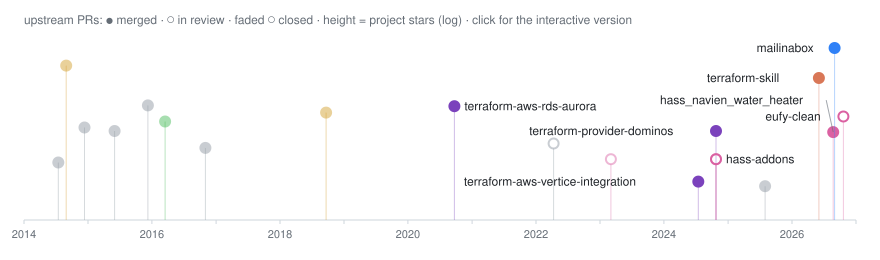

I'm a Site Reliability Engineer. I keep large production systems running, with most of my time going to Kubernetes, Terraform, and observability. When something upstream gets in my way, I fix it there.

### open source contributions

<a href="https://atrepca.github.io/atrepca/">
  <picture>
    <source media="(prefers-color-scheme: dark)" srcset="docs/timeline-dark.svg" />
    <source media="(prefers-color-scheme: light)" srcset="docs/timeline.svg" />
    
  </picture>
</a>

[Interactive timeline](https://atrepca.github.io/atrepca/) · [All OSS contributions](https://github.com/search?q=involves%3Aatrepca+-user%3Aatrepca&type=issues&s=created&o=desc)

---

### recent activity
<!--START_SECTION:activity-->
- Opened PR [#190](https://github.com/jeppesens/eufy-clean/pull/190) in [jeppesens/eufy-clean](https://github.com/jeppesens/eufy-clean)
<!--END_SECTION:activity-->
